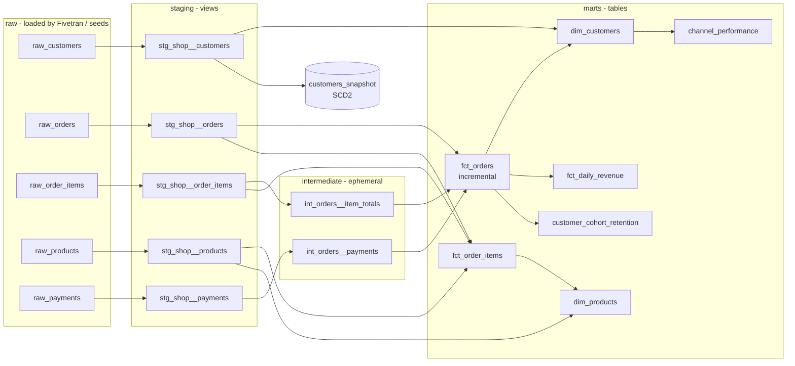

# Snowflake + dbt E-commerce Analytics


An analytics-engineering project in **dbt** that turns raw e-commerce data (customers, orders, order items, products, payments) into tested, documented marts for finance and marketing. It's written to run on **Snowflake** in production and on **DuckDB** locally and in CI, so anyone can clone it and run the full build in under a minute with no cloud account.

## Lineage



## What it demonstrates

| Area | How |
|---|---|
| **Layered modeling** | Sources → staging (rename, cast, clean) → intermediate (ephemeral joins) → marts (core, finance, marketing) |
| **Incremental model** | `fct_orders` merges only orders changed since the last run, with a configurable lookback for late updates. Uses `merge` on Snowflake and `delete+insert` on DuckDB |
| **SCD Type 2** | `customers_snapshot` keeps full history of customer changes with dbt snapshots |
| **Cross-database SQL** | Dispatched macros (`cents_to_dollars`) and dbt's built-in `datediff`, `dateadd`, `date_trunc`, so the same models compile for Snowflake and DuckDB |
| **Messy-source handling** | Deduplicates repeated customer rows, normalizes status casing (`COMPLETED` → `completed`), trims and lowercases emails, separates failed payments and refunds |
| **Testing** | 47 data tests, 2 unit tests, and 2 reconciliation tests (see below) |
| **Environments** | `dev` and `ci` on DuckDB, `prod` on Snowflake with credentials from environment variables |

## Tests

- **Generic:** `unique`, `not_null`, `accepted_values`, and `relationships` on every key and status column
- **Custom generic:** `not_negative`, and a package-free `unique_combination` test for the cohort grain
- **Unit tests (dbt 1.8+):** customer segmentation boundaries (prospect, one-time, repeat, VIP), and net revenue with refunds, split payments, and order numbering
- **Reconciliation:** every paid order collected exactly its order total, returned orders were fully refunded, cancelled orders collected nothing, and the daily finance mart totals match the order fact to the cent

## Results from a full build

12,000 orders from 2,500 customers (2,667 raw rows before deduplication), January 2024 – December 2025.

| Metric | Value |
|---|---:|
| Net revenue | $1,859,091 |
| Refunds | $173,230 |
| Average order value | $179.71 |
| Repeat purchase within 1 month of first order | 41.7% of cohort |
| Still purchasing at month 6 | 16.0% of cohort |

| Customer segment | Customers | Avg lifetime value |
|---|---:|---:|
| VIP (5+ orders, $750+) | 511 | $2,186 |
| Repeat | 1,293 | $509 |
| One-time | 538 | $155 |
| Prospect (no orders) | 158 | $0 |

Referral customers have the highest lifetime value per purchaser ($1,182 vs. $672 for email). The data is synthetic, generated with skewed repeat-buying behavior and realistic source problems.

## Run it locally (DuckDB, no cloud account needed)

```bash
pip install -r requirements.txt
dbt seed  --profiles-dir .                 # load raw data
dbt build --profiles-dir . --exclude resource_type:seed   # models, snapshot, tests
dbt docs generate --profiles-dir . && dbt docs serve --profiles-dir .
```

## Run it on Snowflake

Set `SNOWFLAKE_ACCOUNT`, `SNOWFLAKE_USER`, `SNOWFLAKE_PASSWORD` (and optionally role, warehouse, database), install the adapter, and point `raw_schema` at the schema where your loader lands the source tables:

```bash
pip install dbt-snowflake
dbt build --profiles-dir . --target prod --vars '{raw_schema: SHOP_RAW}'
```

CI runs on DuckDB only. The Snowflake target is configured and the models use cross-database macros, but this repo doesn't run against a live Snowflake account.

## Project layout

```
models/
  staging/        stg_shop__*            one model per source table + sources and tests
  intermediate/   int_orders__*          ephemeral helpers
  marts/core/     fct_orders, fct_order_items, dim_customers, dim_products (+ unit tests)
  marts/finance/  fct_daily_revenue
  marts/marketing/customer_cohort_retention, channel_performance
snapshots/        customers_snapshot (SCD Type 2)
macros/           cents_to_dollars (dispatched), normalize_status, generate_schema_name
tests/            reconciliation tests + custom generic tests
seeds/            raw sample data (regenerate with scripts/generate_seeds.py)
analyses/         ad-hoc SQL compiled by dbt
```

## Tech

dbt · Snowflake · DuckDB · SQL · Jinja · Incremental models · Snapshots (SCD2) · Unit tests · GitHub Actions
